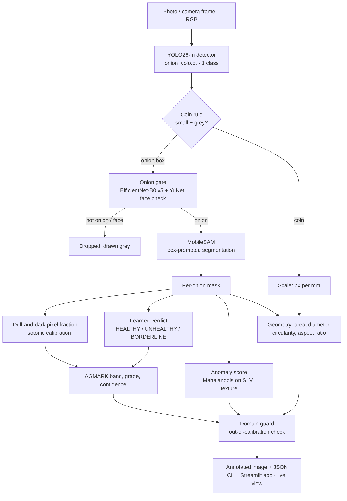

# Onion Quality Assessment & Grading System

Give it a photograph of onions. It finds every onion, checks that each detection really is an onion, decides **HEALTHY / UNHEALTHY**, measures how much of the surface is damaged, assigns an **AGMARK grade** with a confidence, flags onions a human should check, and reports size in millimetres when a ₹1 coin is in the frame.

No clicking or hand-placed prompts. It works on a single photo, from the command line, in a Streamlit app, or live from a laptop or phone camera.

## Datasets

| Dataset | Size | Link |
|---|---|---|
| Image Dataset of Red and White Onion Bulbs and Leaves (Kulkarni, Pawale, Suryawanshi) | 1.5 GB | https://data.mendeley.com/datasets/42bcyncfhy/2 |
| Onion dataset (Aishwarya M P, Padmanabha Reddy) | 109 MB | https://data.mendeley.com/datasets/7nxxn4gj5s/2 |
| TOM2024: tomato, onion and maize pests and diseases (Appiah et al.) | 1.3 GB | https://data.mendeley.com/datasets/3d4yg89rtr/1 |

---

## Results at a glance

| What | Result |
|---|---|
| Grading agreement with a human (quadratic κ, 120 hand-graded onions, cross-validated) | **0.819** [0.724, 0.894] — two humans agree with each other at 0.701 |
| Within one grade band of the human | **95.0%** |
| Onion detection recall | **0.998** (537 of 538 onions found) |
| Detection precision (after the coin rule) | **0.968** |
| HEALTHY / UNHEALTHY, v5 classifier (5-fold CV by photo, 538 tray onions) | **98.3% balanced accuracy**: 193/198 rotten caught, 337/340 sound passed |
| Same, previous v3 classifier | 88.5% |
| Not-onion boxes on 50 real tray photos | 436 of 438 grades unchanged; the 2 removed were bare floor |
| Speed per photo (960×640, warm, CPU) | **1.3 s** on 16 cores · 4.7 s on 2 cores |

**The system grades closer to a human than a second human does.**

---

## Architecture



### The models

| Model | File | Role | Details |
|---|---|---|---|
| **YOLO26-m** | `onion_yolo.pt` | Find onions | 21.8 M params, 1 class, fine-tuned 100 epochs at imgsz 960 on Kaggle |
| **EfficientNet-B0 v5** | `onion_gate_v5.pth` | "Is it an onion?" + healthy/unhealthy | 3 classes (Healthy, Unhealthy, Not Onion), 224 px, ImageNet init |
| **MobileSAM** | `mobile_sam.pt` | Exact outline of each onion | 10.1 M params, used as shipped, prompted with the detector's boxes |
| **YuNet** | `face_yunet.onnx` | Reject boxes on human faces | OpenCV face detector |

Everything after the models is deterministic arithmetic: the same photo always gives the same output.

### Pipeline step by step

1. **Detect.** YOLO returns boxes. A box that is small relative to the photo's median box *and* low in saturation is treated as a coin and used for scale (this rule removed 54 of 72 spurious boxes and no real onions).
2. **Gate.** Each box is classified by the v5 EfficientNet, both tight and with surrounding context. p(not onion) ≥ 0.8 → dropped; 0.5–0.8 → kept but flagged for review; boxes covering a face → dropped. If more than half the boxes are dropped, the whole photo is refused as "not a photograph of onions". Duplicate boxes inside other boxes are removed and onions cut off by the photo edge are marked `partial`.
3. **Segment.** MobileSAM encodes the image once and decodes one mask per box; only the blob under the box centre is kept.
4. **Verdict.** The v5 classifier, run on the masked onion, gives p(unhealthy): ≥ 0.5 → UNHEALTHY, 0.3–0.7 → BORDERLINE (check by hand).
5. **Defect area and grade.** A pixel counts as damage if it is dull *and* dark inside the mask. The raw fraction goes through a 27-point isotonic map calibrated to human judgement, then cut at **0.10 / 0.20 / 0.50** into four bands: Extra Class · Class I · Class II · Below minimum. The grade is kept consistent with the learned verdict. Confidence is distance to the nearest cut; under 0.5 means `needs_review`.
6. **Anomaly score.** The fraction of pixels far (Mahalanobis) from normal onion skin in saturation, brightness and texture: a *different kind* of damage, not just more of it.
7. **Size.** Relative size (`size_ratio`, `size_rank`) is always exact. Millimetres and the AGMARK size code (A < 30 mm, B 30–45, C 45–60, D 60+) are only reported with a coin or a supplied `--px-per-mm`, with a correction for SAM's resolution^1.525 area scaling.
8. **Domain guard.** Warns when a photo is outside what the system was calibrated on: either everything looks strange (median anomaly > 0.30) or nothing registers as damage (no onion above 5%). Grades are still reported, with the warning attached.
9. **Render.** Header bar with counts and healthy/unhealthy split, box and measured outline per onion coloured by band, and a label such as `#3 UNHEALTHY 34%`.

### Live mode: two loops

YOLO with ByteTrack runs on every frame (imgsz 480) and gives each onion a stable ID. The full grade runs every few seconds at 960 and attaches to those IDs, so grades follow the onions as they move. Ungraded onions show grey.

---

## Detailed results

### 1. Grading against human judgement

120 hand-graded onions. Calibration cross-validated by physical onion, so no onion is graded by a curve that saw it.

| | Quadratic κ | Exact band | Within one band |
|---|---|---|---|
| **This system, end to end** | **0.819** | 0.617 | **0.950** |
| Hand-clicked point prompts (earlier phase) | 0.757 | 0.617 | 0.925 |
| *Two humans with each other* | *0.701* | *0.542* | *0.858* |
| *One human with herself* | *0.852* | *0.600* | — |

Box prompts beat point prompts because a box is a less ambiguous prompt for SAM.

### 2. Learned classifier vs the dark-area rule

| | Dark-area rule | Learned classifier (v3) |
|---|---|---|
| 120 hand-graded onions (rule was *fitted* on these) | 83% | **93%** |
| `2. Bulb` photos: healthy wrongly flagged | 53% | 4% |
| `2. Bulb` photos: unhealthy caught | 78% | 100% |
| Single-onion photos, accuracy | 71% | 96% |

This is why HEALTHY/UNHEALTHY comes from the classifier rather than the pixel rule.

### 3. Classifier versions (healthy vs unhealthy)

**v4 evaluation** (`results_v4/eval_report.md`), threshold 0.5:

| Model | Test set | n | Balanced acc | Rotten caught | Sound passed |
|---|---|---|---|---|---|
| v3 `onion_gate.pth` | A · onion_quality held-out ⚠ trained on this source | 4409 | 99.6% | 175/175 | 3559/3589 |
| v3 | **B · Onion_mix, hand-labelled** | 538 | 86.1% | 193/198 | 254/340 |
| v3 | C · VegQual (photo-level labels) | 763 | 93.3% | 501/518 | 220/245 |
| v4 | A · onion_quality held-out | 4409 | 100.0% | 175/175 | 3587/3589 |
| v4 | **B · Onion_mix, hand-labelled** | 538 | 81.1% | 178/198 | 246/340 |
| v4 | C · VegQual | 763 | 90.2% | 446/518 | 231/245 |

v4 looked perfect on its own dataset but did *worse* on new tray photos, so it was not deployed.

**v5 cross-validated evaluation** (`results_v5/cv_report.md`): 538 hand-labelled tray onions from 61 photos, 5 folds split by photo, threshold tuned only on the other folds.

| Model | Balanced @0.5 | Balanced, tuned | Rotten caught | Sound passed |
|---|---|---|---|---|
| v3 `onion_gate.pth` | 85.8% | 88.5% | 180/198 | 293/340 |
| **v5** | **98.8%** | **98.3%** | **193/198** | **337/340** |

VegQual held-out photos (never trained on, per-photo labels): v3 97.2% → **v5 98.8%** (116/116 rotten, 84/86 sound).

v5 was trained on `crops_v4` (onion_quality minus its test split), all 538 `mixed_crops` tray onions and the VegQual train split. It is the model the grader uses now (`calibration.json → onion_gate.weights`).

### 4. Onion gate

| Test | Result |
|---|---|
| 50 tray photos, 438 detections | 436 grades identical with and without the gate; 2 removed were bare floor |
| Highest p(not onion) on a real onion | 0.55 (tight box), 0.65 (with context) |
| Bug-report screenshot (faces, lamp) | All 4 boxes scored 0.98–0.99 → photo refused |
| 50 generic not-onion images | 21 produced detections, 8 still got through (fingernails, a pepper, a cucumber, some people) |

### 5. Speed

| Stage | 16-core CPU | 2-core CPU |
|---|---|---|
| YOLO detection at 960 | 0.34 s | 1.35 s |
| MobileSAM encode + decode | 0.86 s | 3.2 s |
| Everything else | 0.10 s | 0.16 s |
| **Total** | **1.30 s** | **4.7 s** |

Device is picked automatically (CUDA → MPS → CPU). The CUDA path is implemented but has not yet been measured on a GPU; `python -m onion_grader.selftest` reports what your machine actually does.

---

## Known limitations

- **Dark skin reads as damage.** On 50 onions a human called defect-free, 17 (34%) were measured past the detection limit and 7 (14%) dropped to Class II or worse; the worst were the darkest. Three corrections were tried and none worked without losing accuracy. Recalibrate when grading dark cultivars.
- **Thresholds don't transfer** across cameras, lighting or annotators (≈0.13 κ lost against a different annotator). Re-grade ~100 onions from your own setup and rerun the calibration export.
- **The domain guard is a tripwire, not a detector**: it fired on only 20% of a foreign dataset.
- **Counting over-counts** (never under-counts): within ±1 on 72% of photos before the coin rule.
- **BORDERLINE is common on new conditions**: on a new phone and floor, 19 of 126 onions fell in 0.3–0.7, and one onion scored anywhere from 0.2 to 0.8 across 4 shots.
- **No millimetres without a reference object.** One photo cannot separate a small near onion from a large far one.
- **Not visible in a photo:** firmness, dryness, internal soundness, smell, disease species. All grades are *provisional*.
- **Live mode is not validated**: every accuracy number above was measured on still photos.

---

## Quick start

```bash
pip install ultralytics numpy pillow scipy streamlit
pip install lap            # only for live camera tracking
```

```bash
# one photo
python -m onion_grader.grader tray.jpg --out graded.jpg --json grades.json
python -m onion_grader.grader tray.jpg --px-per-mm 3.2     # known scale, no coin

# app
streamlit run onion_grader/app.py

# live camera (q quit · g grade now · s snapshot · space pause)
python -m onion_grader.live
python -m onion_grader.live --source http://192.168.1.7:8080/video     # phone IP camera
python -m onion_grader.live --source clip.mp4 --out graded.mp4 --no-show
```

```python
from onion_grader.grader import OnionGrader
g = OnionGrader()
res = g.grade("tray.jpg")
print(res.summary())
for o in res.onions:
    print(o.index, o.verdict, o.grade, o.defect_area_fraction, o.confidence, o.size_code)
g.render(res, "graded.jpg", "tray.jpg")
```

### Checking it on your own photos

```bash
python -m onion_grader.selftest     # device, weights, per-stage timing
python -m onion_grader.gatecheck    # onion gate on your photos
python -m onion_grader.benchmark --healthy "path/1. Healthy" --unhealthy "path/2. Unhealthy" --limit 50
```

### Per-onion output

| Field | Meaning |
|---|---|
| `verdict` | HEALTHY / UNHEALTHY / BORDERLINE |
| `grade`, `band` | Extra Class · Class I · Class II · Below minimum (none · ≤⅕ · ⅕–½ · >½) |
| `defect_area_fraction` | 0–1, calibrated to human judgement |
| `confidence`, `needs_review` | distance to nearest grade boundary; review if < 0.5 |
| `anomaly_score`, `unusual_kind`, `anomaly_reliable` | unusual kind of damage; withdrawn out of domain |
| `size_ratio`, `size_rank` | relative size, always available |
| `eq_diameter_mm`, `size_code` | A/B/C/D, only with a reference object |
| `box`, `area_px`, `circularity`, `aspect_ratio` | geometry |

Photo-level: `n_onions`, `n_healthy`, `n_unhealthy`, `pct_healthy`, `pct_unhealthy`, `px_per_mm`, `scale_source`, `warnings`, `domain_ok`.

---

## Deploy on Render.com (via GitHub)

The repo ships with a `Dockerfile` and a `render.yaml` Blueprint that run the Streamlit app on CPU.

1. Push the repo to GitHub, including the weights in `onion_grader/` (`onion_yolo.pt`, `mobile_sam.pt`, `onion_gate_v5.pth`, `face_yunet.onnx`, `calibration.json`). All are under GitHub's 100 MB file limit.
2. On Render: **New + → Blueprint**, connect GitHub and pick this repository. Render reads `render.yaml` and creates the web service.
3. Wait for the first build (~10 min: it installs CPU-only PyTorch). Each later push to `main` redeploys automatically.

| Setting | Value | Why |
|---|---|---|
| Plan | **Standard (2 GB)** | The three models peak at **~1.5 GB RAM** while grading a photo. Free and Starter (512 MB) will run out of memory. |
| Runtime | Docker, `python:3.12-slim`, CPU-only torch | Keeps the image small; Render has no GPU |
| Health check | `/_stcore/health` | Streamlit's built-in endpoint |
| `ONION_DISABLE_LIVE=1` | hides the Live camera tab | A server has no camera, and it can't reach a phone on your home wi-fi |

Expect a few seconds per photo, depending on the CPU Render gives you (it took ~9 s on a small test machine). The first photo after a deploy is slower while the models load.

Run the same image locally:

```bash
docker build -t onion-grader .
docker run -p 10000:10000 onion-grader      # open http://localhost:10000
```

---

## Repository layout

```
onion_grader/              the working system
  grader.py                pipeline, rendering, CLI
  gate.py                  onion gate (not-onion + face rejection)
  app.py                   Streamlit app (includes an "Each onion" inspection tab)
  live.py, live_page.py    live camera mode
  calibration.json         every fitted constant and threshold
  benchmark.py             score against labelled folders
  gatecheck.py             measure the onion gate
  selftest.py              device + timing check
  onion_yolo.pt            detector
  mobile_sam.pt            segmenter
  onion_gate_v5.pth        classifier in use (+ _meta.json); onion_gate.pth = v3
  face_yunet.onnx          face detector
  README.md, TECH.md       usage guide and full technical reference
tools/
  add_background_images.py add not-onion negatives to YOLO training data
kaggle_upload/             Kaggle notebooks used to train v4 and v5
results_v4/, results_v5/   evaluation reports and trained weights
datasets/                  onion_quality, Onion_mix, mixed_crops, vegqual_crops, crops_v4
research papers/           related literature
report.docx, onion_quality_presentation.pptx   project report and slides
Dockerfile, render.yaml     Render.com deployment
requirements.txt           Python dependencies (torch installed separately)
.streamlit/config.toml     app theme and server settings
```

`datasets/`, `kaggle_upload/`, `results_v*/` and `venv/` are not committed (see `.gitignore`).

### Configuration

All fitted constants live in `onion_grader/calibration.json`: defect thresholds and isotonic map, anomaly Gaussian, coin rule, detector settings, domain guard, onion gate and verdict thresholds. The AGMARK ⅕ and ½ boundaries are statutory and never fitted. The deployed constants were fitted on all labelled data; every number in this README comes from cross-validated fits that never saw the onion they scored.

For the full technical description of each stage see [`onion_grader/TECH.md`](onion_grader/TECH.md); for usage details see [`onion_grader/README.md`](onion_grader/README.md).
